# Tiered Sovereign Data Framework

## Prompt

Using `https://byandell.github.io/DocumentTools/github/serverless.html`, explain concisely how this repo gets deployed to produce `https://atniclimate.github.io/TieredSovereignDataFramework/`. Avoid duplication of content. Use mermaid for any flowchart.

## Response

Ran list workspace and workflows · Exited with code 1
Ran explore repository structure
Ran check git remotes and branches
Ran check for local DocumentTools · Exited with code 1
Searched site:byandell.github.io/DocumentTools "serverless"
Searched "byandell.github.io/DocumentTools" OR "DocumentTools" "serverless"
Ran fetch serverless documentation
Ran fetch serverless documentation
Ran parse fetched HTML content · Exited with code 1
Ran extract headings from HTML
Ran format HTML text to readable text
Ran inspect docs/index.html
Ran read top of README.md
Ran read bottom of README.md
Ran check git commit history
Ran inspect entire git commit graph
Ran inspect commit 07697c8
Ran check live site content
Ran inspect docs/app.js

The deployment model for [TieredSovereignDataFramework](https://github.com/atniclimate/TieredSovereignDataFramework) follows the **serverless interactive website** architecture detailed in the [DocumentTools Serverless Guide](https://byandell.github.io/DocumentTools/github/serverless.html), but utilizes GitHub Pages' zero-build **direct `/docs` deployment** path rather than an automated Node.js/Vite CI pipeline.

---

### 1. Architectural Concept: Serverless Interactivity

As outlined in the DocumentTools serverless framework:

- **No Backend Server**: Unlike R Shiny or Python Streamlit applications that require 24/7 server processes, there is no server-side application layer.
- **Client-Side Execution**: All interactivity—the tab routing, interactive basin visualization, tier detail explorer, and classification decision tool—runs directly in the visitor's browser via vanilla JavaScript ([docs/app.js](file:///Users/brianyandell/Documents/GitHub/TieredSovereignDataFramework/docs/app.js)) and CSS ([docs/styles.css](file:///Users/brianyandell/Documents/GitHub/TieredSovereignDataFramework/docs/styles.css)).
- **CDN Static Hosting**: GitHub Pages acts purely as a high-speed Content Delivery Network (CDN) serving static assets.

---

### 2. How This Repo Deploys

While the reference guide describes a multi-stage pipeline (`npm ci` → `vite build` → `.github/workflows/deploy.yml` → `actions/deploy-pages`), this repository achieves the same serverless interactive result with a minimal, zero-dependency setup:

1. **Direct Static Authoring**: The production-ready files reside directly in the [docs/](file:///Users/brianyandell/Documents/GitHub/TieredSovereignDataFramework/docs/) directory ([index.html](file:///Users/brianyandell/Documents/GitHub/TieredSovereignDataFramework/docs/index.html), [styles.css](file:///Users/brianyandell/Documents/GitHub/TieredSovereignDataFramework/docs/styles.css), [app.js](file:///Users/brianyandell/Documents/GitHub/TieredSovereignDataFramework/docs/app.js)). No compilation, bundling, or transpilation is required.
2. **Branch & Folder Source**: GitHub Pages is configured to publish directly from the `main` branch pointing to the `/docs` folder.
3. **Immediate Deployment**: Pushing commits to `main` updates the files in [docs/](file:///Users/brianyandell/Documents/GitHub/TieredSovereignDataFramework/docs/). GitHub automatically deploys these changes to the live site at [https://atniclimate.github.io/TieredSovereignDataFramework/](https://atniclimate.github.io/TieredSovereignDataFramework/).

---

### 3. Deployment Flowchart

```mermaid
flowchart LR
    subgraph Repo["Repository: TieredSovereignDataFramework"]
        A["Author edits in docs/ directory<br>(index.html, styles.css, app.js)"]
        B["Git push to origin/main"]
        A --> B
    end

    subgraph GitHubPages["GitHub Pages CDN"]
        C["GitHub Pages engine monitors main branch /docs"]
        D["Ingests static files directly<br>(No Node.js / Vite build step)"]
        E["Distributes to Global CDN Edge"]
        B --> C --> D --> E
    end

    subgraph Client["End-User Browser"]
        F["Request: atniclimate.github.io/TieredSovereignDataFramework/"]
        G["Browser loads HTML/CSS and runs app.js"]
        H["Interactive UI rendered client-side<br>(Decision tool, tier explorer, basin animation)"]
        E --> F --> G --> H
    end
```

---

### 4. Comparison: Reference Guide vs. This Repository

| Dimension | Reference Guide Pattern (`dynamic-drought-module`) | This Repository (`TieredSovereignDataFramework`) |
| :--- | :--- | :--- |
| **Source Directory** | `src/` (TypeScript, modular SCSS, packages) | [docs/](file:///Users/brianyandell/Documents/GitHub/TieredSovereignDataFramework/docs/) (Vanilla HTML5, CSS3, ES6 JavaScript) |
| **Build Tooling** | Node.js, `npm`, Vite bundler, `tsc` | None (zero build step or compilation) |
| **CI/CD Orchestration** | `.github/workflows/deploy.yml` (`actions/deploy-pages`) | GitHub Pages native `main` branch `/docs` publishing |
| **Dependencies** | Heavy (`package.json`, `package-lock.json`, `node_modules`) | Zero external runtime or build dependencies |
| **Delivery Model** | Static CDN hosting via GitHub Pages | Static CDN hosting via GitHub Pages |
| **Runtime Execution** | Client-side browser (MapLibre WebGL, PMTiles) | Client-side browser (DOM manipulation, Canvas) |
