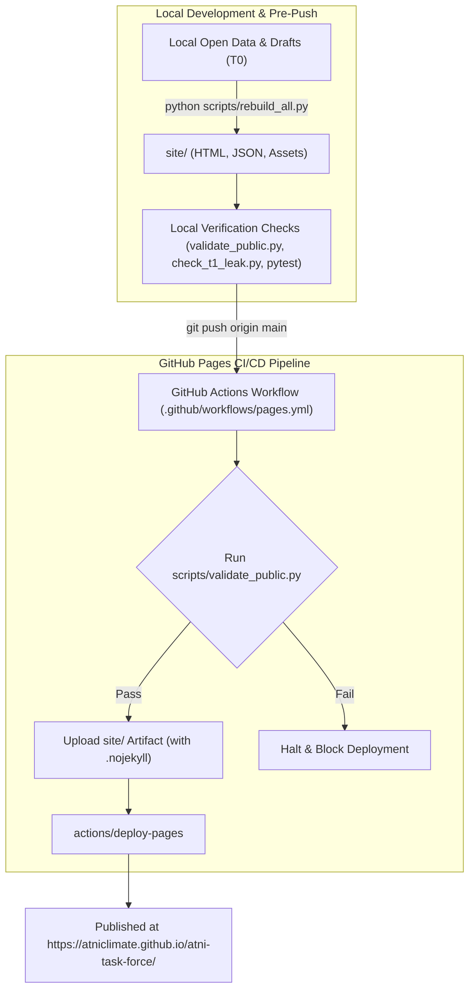

# ATNI Task Force

## Prompts

- Explain how this repo is used to deploy `https://atniclimate.github.io/atni-task-force/`.
- Change "Summary of the Lifecycle" into mermaid flowchart.

## Response

The repository `atniclimate/atni-task-force` deploys to [https://atniclimate.github.io/atni-task-force/](https://atniclimate.github.io/atni-task-force/) through a secure, gated static-publishing architecture using **GitHub Pages** and **GitHub Actions**.

Here is how the deployment pipeline and publishing process work:

---

### 1. The Core Publishing Architecture: `site/` Only

- **Zero-Build at Deploy Time**: The site is completely static (vanilla HTML, CSS, JavaScript, JSON data, SVG maps, self-hosted fonts, and PDFs). No static site generator (like Jekyll, Hugo, or Next.js) builds the site on the GitHub Actions runner.
- **Isolated Publication Root**: Only the contents of the [`site/`](file:///Users/brianyandell/Documents/GitHub/atni-task-force/site) directory are published. The repository root, build scripts, tests, planning notes, and documentation folders are never uploaded to the public web server.
- **Jekyll Bypass ([`site/.nojekyll`](file:///Users/brianyandell/Documents/GitHub/atni-task-force/site/.nojekyll))**: GitHub Pages defaults to running Jekyll. A `.nojekyll` file inside `site/` instructs GitHub Pages to bypass Jekyll processing so that dotfiles, raw assets, and directory structures serve directly as-is.
- **Relative Path Routing**: All asset links and URLs within [`site/`](file:///Users/brianyandell/Documents/GitHub/atni-task-force/site) use relative paths so pages resolve correctly under the GitHub Pages subpath (`/atni-task-force/`).

---

### 2. The Deployment Workflow (`.github/workflows/pages.yml`)

The automated deployment is handled by a single GitHub Actions workflow:

1. **Triggers**:
   - Pushes to the `main` branch that touch:
     - `site/**`
     - `scripts/validate_public.py`
     - `scripts/pour_claim_refs.py`
     - `docs/CONTENT-SLOTS.md`
     - `.github/workflows/pages.yml`
   - Manual trigger via `workflow_dispatch`.
2. **Pre-Deploy Release Boundary Check**:
   - Sets up Python 3.12 and installs `pymupdf`.
   - Runs `scripts/validate_public.py`.
   - **Any failure halts the pipeline immediately**, preventing deployment if any privacy, data integrity, or schema check fails.
3. **Packaging and Deployment**:
   - Uses `actions/configure-pages@v6` to set up GitHub Pages metadata.
   - Uses `actions/upload-pages-artifact@v5` targeting `path: site` with `include-hidden-files: true` (ensuring `site/.nojekyll` is preserved).
   - Uses `actions/deploy-pages@v5` to deploy the artifact to the GitHub Pages environment.

---

### 3. Pre-Deployment Data Flow and Build Pipeline

Because GitHub Actions does not compile the site, content updates are built locally by maintainers and committed into the `site/` directory using the script toolchain:

- **Orchestrator (`scripts/rebuild_all.py`)**:
  1. Compiles claims from open data (`energy_claims.py`, `climate_claims.py`, `project_claims.py`).
  2. Builds data plates and embeds figures into pages (`build_plates.py`).
  3. Updates counts, project maps, and manifests (`site_count_claims.py`, `build_project_map.py`, `build_index.py`).
  4. Runs the resource model and generates interactive explorer blocks (`resource_model.py`, `build_explorer.py`).
  5. Updates library strips, What's New entries, share cards, and briefing PDFs (`build_library_strip.py`, `build_whats_new.py`, `build_share_cards.py`, `build_briefing.py`, `build_briefing_pdf.py`).
  6. Pours claim references and updates page metadata (`pour_claim_refs.py`, `add_page_meta.py`).
- **Local Testing**:
  - Run `python -m http.server 8771 --bind 127.0.0.1 --directory site` to preview locally before pushing.

---

### 4. Sovereign Data Governance & Security Gates

The repository is governed by the ATNI Tiered Sovereign Data Framework ([`DATA-TIERS.md`](file:///Users/brianyandell/Documents/GitHub/atni-task-force/DATA-TIERS.md)):

- **Tier 0 (T0 - Public)**: Only T0 data and text are permitted in `site/`.
- **Tier 1 (T1 - Community Network)**: Work-in-progress, notes, and community information stay in `planning-T1/`, `work/`, and `files-unsorted/`. These folders are local and gitignored; they are never tracked in Git or published.
- **Pre-Push Boundary Enforcement**:
  - [`scripts/validate_public.py`](file:///Users/brianyandell/Documents/GitHub/atni-task-force/scripts/validate_public.py): Enforces that no private paths, email addresses, external CDNs/trackers, Google Drive links, em dashes, unverified claims, or invalid schemas exist in `site/`.
  - `scripts/check_t1_leak.py`: Scans `site/` against local T1 documents to detect and block any verbatim text leakage.
  - `tests/`: Automated unit tests via `pytest` run in CI via [`.github/workflows/check.yml`](file:///Users/brianyandell/Documents/GitHub/atni-task-force/.github/workflows/check.yml) on branches and PRs (with read-only permissions and no deploy capability).

---

### Summary of the Lifecycle

