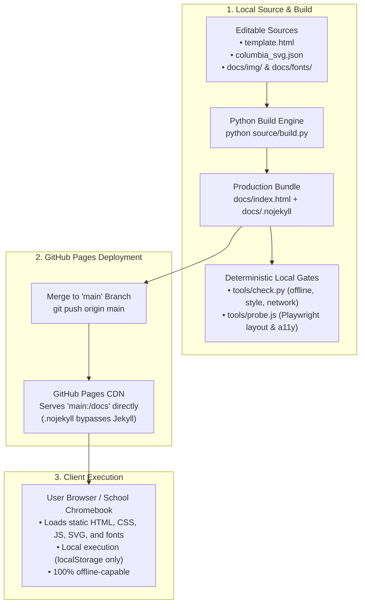

# Climate Change Curriculum

## Prompt

Using `https://byandell.github.io/DocumentTools/github/serverless.html`, explain concisely how this repo gets deployed to produce `https://atniclimate.github.io/climate-curriculum/`. Avoid duplication of content. Use mermaid for any flowchart.

## Response

Ran list repository contents
Analyzed CLAUDE.md:L1-100
Analyzed CLAUDE.md:L100-114
Analyzed README.md:L1-73
Ran fetch serverless documentation
Ran check for DocumentTools directory · Exited with code 1
Searched site:byandell.github.io/DocumentTools github serverless
Searched "byandell" "DocumentTools" OR "Document Digital Tools"
Searched "byandell.github.io/DocumentTools" serverless
Ran check git configuration and history
Ran list directories content
Analyzed build.py:L1-23
Ran fetch serverless documentation
Ran fetch serverless documentation
Ran parse serverless.html content · Exited with code 1
Ran extract text outline from serverless.html
Ran extract middle section of serverless.html
Ran check for .github directory
Analyzed check.py:L1-100
Ran list .claude directory
Ran list claude skills and workflows
Ran read cc-release-check skill

Following the serverless static architecture principles described in [DocumentTools: Serverless Interactive Website](https://byandell.github.io/DocumentTools/github/serverless.html), this repository operates with **zero application backend server** (no active R/Shiny or Python server). GitHub Pages acts as a high-speed static CDN, and all computation and rendering run entirely on the visitor's device.

---

### Deployment Architecture & Lifecycle

---

### Step-by-Step Breakdown

1. **Local Build & Assembly**:
   - Developers edit the master template in [template.html](file:///Users/brianyandell/Documents/GitHub/climate-curriculum/source/template.html).
   - Running [build.py](file:///Users/brianyandell/Documents/GitHub/climate-curriculum/source/build.py) injects the map vector geometry from [columbia_svg.json](file:///Users/brianyandell/Documents/GitHub/climate-curriculum/source/columbia_svg.json) into the template, compiling the single-file production output to [index.html](file:///Users/brianyandell/Documents/GitHub/climate-curriculum/docs/index.html).

2. **Deterministic Quality Gates**:
   - Before committing, [check.py](file:///Users/brianyandell/Documents/GitHub/climate-curriculum/tools/check.py) verifies strict constraints: no external CDNs or network calls, no missing local media, correct slide IDs, and ATNI editorial style rules.
   - [probe.js](file:///Users/brianyandell/Documents/GitHub/climate-curriculum/tools/probe.js) (via Playwright) checks responsiveness, tap target sizes, and accessibility standards across target viewports.

3. **Publishing via Native GitHub Pages (`main:/docs`)**:
   - Unlike projects that compile in the cloud using GitHub Actions, this repo uses GitHub Pages' native branch/folder deployment model pointing directly to `main:/docs`.
   - The presence of [docs/.nojekyll](file:///Users/brianyandell/Documents/GitHub/climate-curriculum/docs/.nojekyll) instructs GitHub Pages to bypass Jekyll processing and serve the files directly as static assets.
   - When changes are committed and merged into the `main` branch, GitHub Pages automatically deploys the contents of `docs/` to `https://atniclimate.github.io/climate-curriculum/`.

4. **Client-Side Execution**:
   - The visitor's browser downloads the static bundle directly from the GitHub Pages CDN.
   - Navigation, slide state, and map interactions run purely in client-side JavaScript without backend calls. Any user input remains in browser `localStorage`, ensuring the site operates fully offline.

---

### Implementation Comparison

| Architectural Layer | Dynamic Drought Module (in `serverless.html`) | Climate Curriculum (this repo) |
| --- | --- | --- |
| **Build Toolchain** | Node.js, TypeScript, Vite, `npm run build` | Python ([build.py](file:///Users/brianyandell/Documents/GitHub/climate-curriculum/source/build.py)) |
| **Output Directory** | Ephemeral `dist/` | Tracked [docs/](file:///Users/brianyandell/Documents/GitHub/climate-curriculum/docs/) directory |
| **Deployment Mechanism** | GitHub Actions (`deploy.yml` with OIDC) | Native GitHub Pages (`main:/docs` with `.nojekyll`) |
| **Data & Assets** | Bundled PMTiles & public REST APIs | Self-contained inline SVG, local fonts, and images |
