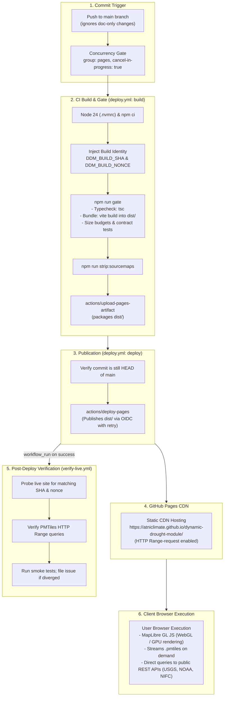

# Dynamic Drought Module

## Prompt

Using `https://byandell.github.io/DocumentTools/github/serverless.html`, explain concisely how this repo gets deployed to produce `https://atniclimate.github.io/dynamic-drought-module/`. Avoid duplication of content. Use mermaid for any flowchart.

## Response

Based on the architecture detailed in [serverless.html](https://byandell.github.io/DocumentTools/github/serverless.html), the **Dynamic Drought Module (DDM)** runs with **zero application backend server** (unlike traditional R Shiny or Python Streamlit apps). Instead, GitHub Pages functions purely as a high-speed static CDN, while client browsers execute the mapping engine, stream vector tiles, and fetch public environmental data directly.

---

### Deployment Flowchart

---

### Key Deployment Stages

1. **Trigger & Concurrency Management** ([deploy.yml](file:///Users/brianyandell/Documents/GitHub/dynamic-drought-module/.github/workflows/deploy.yml#L9-L58)):
   - A push to `main` triggers deployment, ignoring markdown and documentation files outside the build tree.
   - The `concurrency: group: pages, cancel-in-progress: true` configuration cancels obsolete in-progress runs when commits land in rapid succession, avoiding race conditions and transient CDN deployment collisions.

2. **Deterministic Build & Quality Gate** ([deploy.yml](file:///Users/brianyandell/Documents/GitHub/dynamic-drought-module/.github/workflows/deploy.yml#L60-L126)):
   - **Environment**: Pinned to Node `24.20.0` via [.nvmrc](file:///Users/brianyandell/Documents/GitHub/dynamic-drought-module/.nvmrc) with dependencies strictly locked by `npm ci` via [package-lock.json](file:///Users/brianyandell/Documents/GitHub/dynamic-drought-module/package-lock.json).
   - **Provenance Stamping**: Injects `DDM_BUILD_SHA` and `DDM_BUILD_NONCE` into the HTML root so browser instances can be tied directly to their CI run.
   - **Gate**: `npm run gate` enforces static typechecking (`tsc`), asset bundling (`vite build`), bundle-size limits, and contract tests before any artifact is created.
   - **Packaging**: Debug source maps are stripped (`npm run strip:sourcemaps`), and the resulting static files in `dist/` are archived via `actions/upload-pages-artifact`.

3. **Secure Pages Publication** ([deploy.yml](file:///Users/brianyandell/Documents/GitHub/dynamic-drought-module/.github/workflows/deploy.yml#L127-L177)):
   - **Least Privilege**: The deploy job alone holds `pages: write` and `id-token: write` OIDC permissions.
   - **Freshness Check**: Verifies the commit is still `HEAD` of `main` to prevent re-runs from deploying superseded builds.
   - **Deployment**: `actions/deploy-pages` deploys the bundle directly to the Pages environment, including an automated 30-second backoff retry for transient backend delays.

4. **Independent Post-Deploy Verification** ([verify-live.yml](file:///Users/brianyandell/Documents/GitHub/dynamic-drought-module/.github/workflows/verify-live.yml#L1-L50)):
   - Triggered automatically via `workflow_run` after publication succeeds.
   - Queries the live site at `https://atniclimate.github.io/dynamic-drought-module/` to ensure the published DOM matches the repository commit SHA.
   - Verifies that GitHub Pages correctly serves partial HTTP `Range` requests for `.pmtiles` vector archives and automatically opens an issue if divergence or regression is detected.
