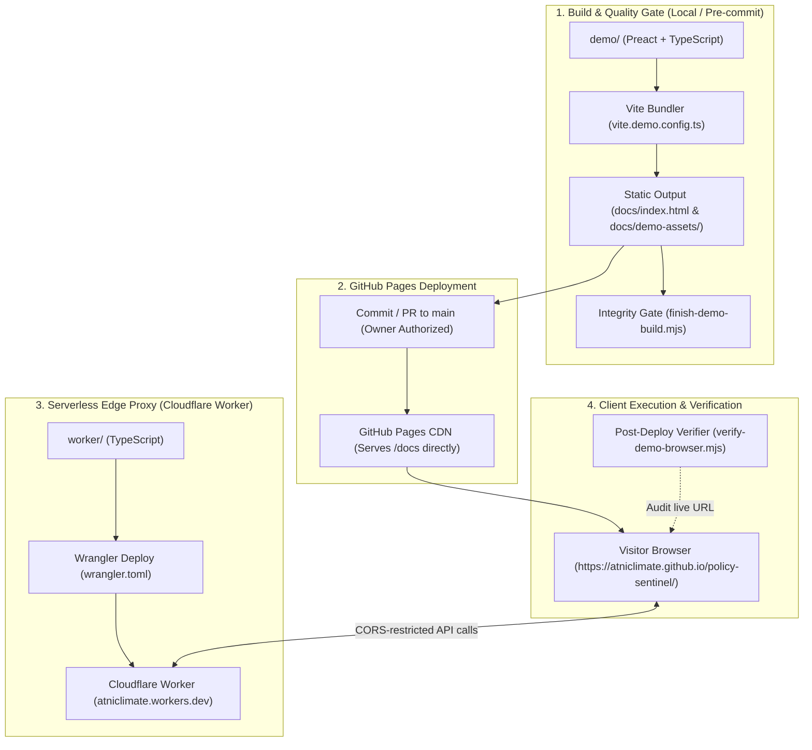

# Policy Sentinel

## Prompt

Using <https://byandell.github.io/DocumentTools/github/serverless.html>, explain concisely how this repo gets deployed to produce
<https://atniclimate.github.io/policy-sentinel/>. Avoid duplication of content. Use mermaid for any flowchart.

## Response

Following the serverless deployment pattern documented in [DocumentTools: Serverless Interactive Website](https://byandell.github.io/DocumentTools/github/serverless.html), this repository deploys without a dedicated 24/7 web application server (such as Shiny, Flask, or Django).

Instead, it couples a **static client-side Single-Page Application (SPA) on GitHub Pages** with a **serverless edge proxy (Cloudflare Worker)** to handle external API communication securely.

---

### Deployment Pipeline



---

### Key Stages in the Deployment Lifecycle

#### 1. Static Bundling & Local Quality Gate

- **Compiling the Frontend**: Running `npm run demo:build` executes Vite via `vite.demo.config.ts`. With `base: './'`, assets are generated using relative URLs, outputting static files directly into `docs/index.html` and `docs/demo-assets/`.
- **Integrity & Safeguard Scan**: `scripts/finish-demo-build.mjs` acts as the local deterministic gate:
  - Verifies asset signatures and packages licenses into `docs/THIRD-PARTY-NOTICES.txt`.
  - Scans compiled output to guarantee zero tracking pixels, analytics scripts, or leaked secrets.
  - Ensures `docs/.nojekyll` is present so GitHub Pages bypasses Jekyll processing.

#### 2. Publishing to GitHub Pages

- Unlike workflows that compile on a GitHub Actions runner, reviewed `docs/` artifacts in this repository are committed directly to `main` via authorized Pull Requests (governed by `AGENTS.md`).
- GitHub Pages serves the `/docs` directory directly as a high-speed static CDN at **<https://atniclimate.github.io/policy-sentinel/>**.

#### 3. Edge Serverless Proxy (Cloudflare Worker)

- While pure client-side apps query public endpoints directly, federal policy APIs (e.g., GovInfo, Congress.gov, Regulations.gov) require API keys (`DATA_GOV_API_KEY`) and enforce strict rate limits.
- To prevent secrets from leaking into the browser and avoid CORS blocks, the backend proxy in `worker/wrangler.toml` is deployed to Cloudflare Workers (`npm run demo:worker:deploy`). It enforces origin checks, version-scoped caching, and rate limiting.

#### 4. Live Release Verification

- Mirroring the `verify-live.yml` concept in `serverless.html`, post-deployment verification is executed via:

  ```bash
  node scripts/verify-demo-browser.mjs --url https://atniclimate.github.io/policy-sentinel/ --out <folder>
  ```

- `scripts/verify-demo-browser.mjs` audits the live URL: it performs an axe WCAG accessibility check, validates CSP/network boundaries, and confirms that all deployed runtime files match the committed build.
